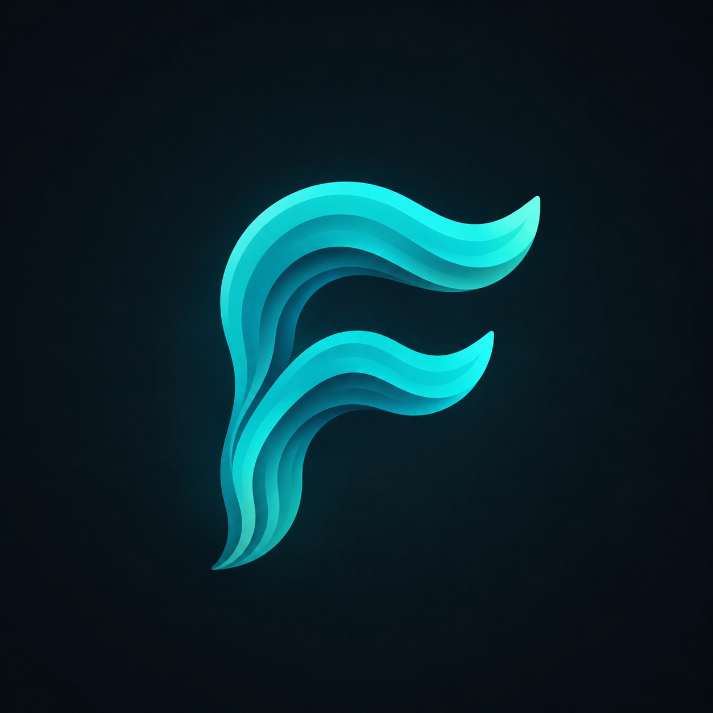
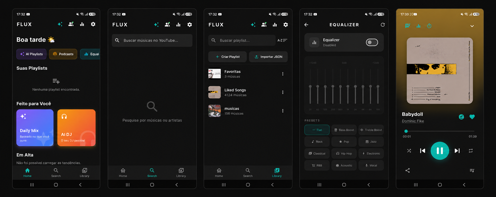
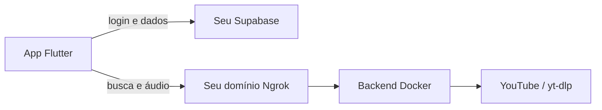

<div align="center">
  

  # Flux

  **Sua música, suas playlists, seu servidor.**

  Um player de música moderno feito em Flutter, com streaming, downloads, letras, equalizador e recursos sociais.

  
  
  
  
  
</div>

---

## 📱 O aplicativo

<div align="center">
  
</div>

<p align="center">
  Home &nbsp;•&nbsp; Busca &nbsp;•&nbsp; Biblioteca &nbsp;•&nbsp; Equalizador &nbsp;•&nbsp; Player
</p>

---

## ✨ Recursos

- Busca e reprodução de músicas
- Playlists, favoritas e capas personalizadas
- Download para ouvir offline
- Letras sincronizadas e tradução
- Equalizador de 10 bandas com presets
- Fila, modo aleatório e repetição
- Biblioteca de arquivos locais
- Histórico e artistas mais ouvidos
- Perfis, amigos, playlists públicas e atividade musical
- Sincronização entre dispositivos pelo Supabase

## 🧩 Como funciona



Cada instalação usa contas próprias. O projeto não depende do computador, do Docker Hub, do Ngrok ou do Supabase do desenvolvedor original.

## 🚀 Instalação

### Pré-requisitos

- [Flutter SDK](https://docs.flutter.dev/get-started/install)
- [Docker Desktop](https://www.docker.com/products/docker-desktop/)
- Uma conta no [Supabase](https://supabase.com/)
- Uma conta no [Ngrok](https://ngrok.com/)
- Celular com depuração USB ou outro dispositivo Flutter

### 1. Clone e prepare o projeto

```powershell
git clone https://github.com/PramioIFC/Flux.git
cd Flux
.\setup.ps1
```

O script cria os arquivos locais `.env` e `config.json`. Eles são ignorados pelo Git para proteger suas configurações.

### 2. Configure o Ngrok

Abra `.env` e preencha:

```dotenv
NGROK_AUTHTOKEN=seu_authtoken
NGROK_DOMAIN=seu-dominio.ngrok-free.app
```

- Pegue o token em [Your Authtoken](https://dashboard.ngrok.com/get-started/your-authtoken).
- Pegue ou crie o domínio em [Domains](https://dashboard.ngrok.com/domains).
- Use o domínio sem `https://` e sem `/` no final.
- Token e domínio precisam pertencer à mesma conta Ngrok.

### 3. Configure o Supabase

1. Crie um projeto no Supabase. Mantenha **Enable Data API** e **Automatically expose new tables** ativados. O RLS pode ser ativado nessa tela; o script também o habilita.
2. Aguarde o projeto ficar com status **Healthy**.
3. Abra o **SQL Editor** e crie uma nova consulta.
4. Abra [`supabase/schema.sql`](supabase/schema.sql), copie todo o conteúdo, cole no editor e clique em **Run**.
5. A resposta esperada é **Success. No rows returned.** Isso significa que a estrutura foi criada corretamente.
6. Abra **Table Editor** e confirme que estas tabelas aparecem:
   - `user_data`
   - `listening_history`
   - `now_playing`
7. Em **Project Settings → API**, copie a URL e a chave pública `anon`.
8. Preencha `config.json`:

```json
{
  "SUPABASE_URL": "https://seu-projeto.supabase.co",
  "SUPABASE_ANON_KEY": "sua_chave_anon_publica"
}
```

O SQL cria as tabelas, funções e políticas de segurança necessárias para usuários, playlists, amigos e histórico.

> A tela inicial pode continuar mostrando **No migrations**. Isso é normal quando o banco é preparado pelo SQL Editor.

Para que o link de confirmação não termine em uma página local inexistente, abra **Authentication → URL Configuration** no Supabase e altere **Site URL** de `http://localhost:3000` para uma página válida, por exemplo:

```text
https://github.com/PramioIFC/Flux
```

O Supabase confirma o endereço antes de fazer esse redirecionamento. Ao criar uma conta no Flux:

1. Abra o e-mail enviado pelo Supabase.
2. Clique no link de confirmação.
3. Volte ao aplicativo e faça login.
4. Confira o selo **E-mail verificado** em **Configurações**.

Se o link terminar em uma página não encontrada, confira a **Site URL**. A confirmação pode ter sido concluída antes do redirecionamento; tente fazer login novamente.

### 4. Inicie o backend

Com o Docker Desktop aberto:

```powershell
docker compose up --build
```

A imagem é construída diretamente de [`server/Dockerfile`](server/Dockerfile). Quando o terminal mostrar o endereço público, teste:

```powershell
Invoke-RestMethod -Uri "https://seu-dominio.ngrok-free.app/trending" -Headers @{"ngrok-skip-browser-warning"="true"}
```

### 5. Execute o aplicativo

```powershell
flutter pub get
flutter run lib/main.dart --dart-define-from-file=config.json
```

No Flux, abra **Configurações → Servidor Ngrok**, cole a URL completa (`https://...`) e salve.

### 6. Checklist do primeiro teste

- [ ] O Docker continua aberto e mostra o link público do Ngrok.
- [ ] `/trending` retorna uma lista de músicas.
- [ ] O cadastro foi confirmado pelo e-mail.
- [ ] O e-mail aparece como verificado nas configurações.
- [ ] A URL completa do Ngrok foi salva no aplicativo.
- [ ] Busca, reprodução e download de uma música foram testados.

## 🛠️ Comandos úteis

| Ação | Comando |
|---|---|
| Iniciar/reconstruir | `docker compose up --build` |
| Ver logs | `docker compose logs -f flux-server` |
| Encerrar | `docker compose down` |
| Verificar Flutter | `flutter analyze` |
| Executar o app | `flutter run lib/main.dart --dart-define-from-file=config.json` |

## 📁 Estrutura do projeto

```text
Flux/
├── assets/               # ícones e imagens
├── lib/                  # aplicativo Flutter
│   ├── providers/        # estado e reprodução
│   ├── screens/          # telas do aplicativo
│   ├── services/         # Supabase, histórico e arquivos locais
│   └── widgets/          # componentes reutilizáveis
├── server/               # API Flask, yt-dlp e túnel Ngrok
├── supabase/schema.sql   # banco, RPCs e políticas RLS
├── compose.yaml          # ambiente Docker
├── .env.example          # modelo de configuração Ngrok
└── config.example.json   # modelo de configuração Supabase
```

## 🔐 Segurança

- Nunca publique `.env` ou `config.json`.
- Nunca coloque a `service_role` do Supabase no aplicativo; use somente a chave pública `anon`.
- Se um token Ngrok for exposto, revogue-o pelo painel e gere outro.
- O backend não possui token ou domínio gravado no código.

## 🩺 Solução de problemas

<details>
<summary><strong>O Docker não conecta</strong></summary>

Abra o Docker Desktop e aguarde o Docker Engine terminar de iniciar. Confirme com `docker version`.
</details>

<details>
<summary><strong>O Ngrok informa que o domínio pertence a outra conta</strong></summary>

Use um domínio criado na mesma conta do authtoken configurado em `.env`.
</details>

<details>
<summary><strong>O app pede a configuração do Supabase</strong></summary>

Confirme que `config.json` está preenchido e execute com `--dart-define-from-file=config.json`.
</details>

<details>
<summary><strong>O servidor abre, mas a música não toca</strong></summary>

Teste `/trending`, confira se a URL completa foi salva no aplicativo e consulte `docker compose logs -f flux-server`.
</details>

---

<div align="center">
  Feito com Flutter, Python e muita música. 🎶
</div>

# NEOflux
